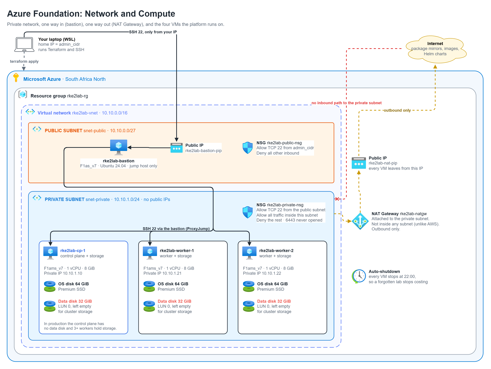

# RKE2 Platform Lab

A self-managed Kubernetes platform on Azure VMs: RKE2, Cilium and Rook-Ceph,
with monitoring, backups and GitOps on top. I build it one layer at a time.
Each layer is deployed and tested before the next one starts, and each write-up
explains what problem the layer solves and why I chose it over the alternatives.



## Parts

| Part | Layer | Status |
|---|---|---|
| 1 | [Azure foundation](docs/01-azure-foundation.md): private network, bastion, NAT Gateway, VMs | Deployed and tested |
| 2 | Automation with Ansible | |
| 3 | Kubernetes with RKE2 | |
| 4 | Pod networking with Cilium | |
| 5 | Storage with Rook-Ceph | |
| 6 | Monitoring | |
| 7 | Backups and recovery | |
| 8 | GitOps and CI | |

## Running Part 1

You need an Azure subscription, the Azure CLI (logged in), Terraform and an SSH key.

```bash
cp terraform/terraform.tfvars.example terraform/terraform.tfvars   # fill in your values
terraform -chdir=terraform init
terraform -chdir=terraform apply -var-file=free-trial.tfvars
bash tests/01-foundation.sh
terraform -chdir=terraform destroy -var-file=free-trial.tfvars
```

`free-trial.tfvars` fits the layout into the 4 vCPUs an Azure Free Trial allows
per region (2 workers, 1 vCPU VMs). Without it you get the production layout:
a dedicated control plane and 3 workers. The write-up explains why production
needs at least three.
