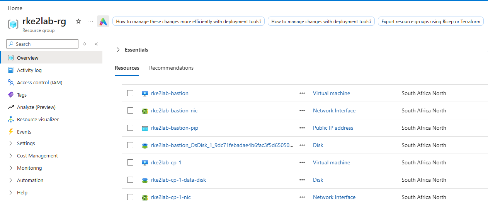
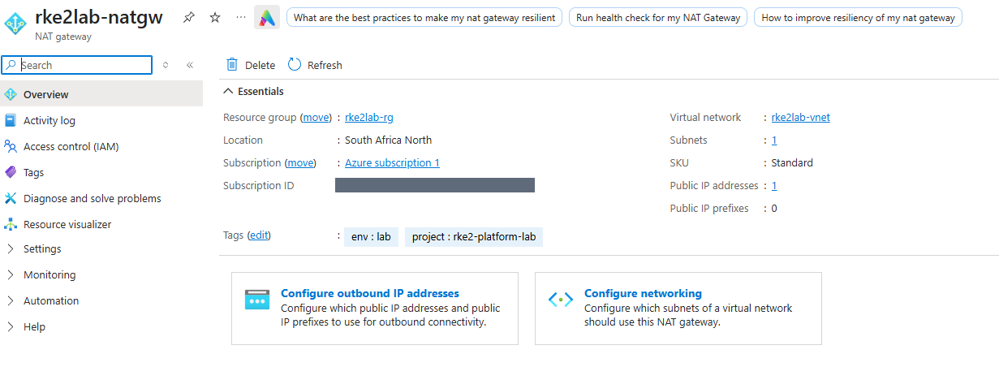

# Part 1: Azure foundation


## The problem

Before there is any Kubernetes, storage or app, the platform needs somewhere to
live. I wanted that place to meet five conditions:

1. Nothing in the cluster is reachable from the internet.
2. I still have one controlled way in to build and operate it.
3. The machines can download packages, container images and Helm charts.
4. I can destroy all of it tonight and get the exact same thing back tomorrow.
5. If I forget it running, it does not quietly run up a bill.

This part covers those five points and nothing else.

## What gets built

| Resource | Name | Purpose |
|---|---|---|
| Resource group | `rke2lab-rg` | Holds everything. Deleting it deletes the lab. |
| Virtual network | `rke2lab-vnet` (`10.10.0.0/16`) | The private network |
| Public subnet | `snet-public` (`10.10.0.0/27`) | The bastion, the only VM with a public IP |
| Private subnet | `snet-private` (`10.10.1.0/24`) | The cluster VMs. No public IPs, no default internet access. |
| Bastion | `rke2lab-bastion` | The only way in, over SSH |
| NAT Gateway | `rke2lab-natgw` + `rke2lab-nat-pip` | The only way out, for the private subnet |
| NSGs | `rke2lab-public-nsg`, `rke2lab-private-nsg` | One firewall per subnet |
| Cluster VMs | `rke2lab-cp-1`, `rke2lab-worker-1`, `rke2lab-worker-2` | Future control plane and workers |
| Data disks | `rke2lab-<vm>-data-disk` | One empty 32 GiB disk at LUN 0 on each storage node (cp-1 and both workers here) |
| Shutdown schedules | | Every VM stops at 22:00 |

Everything runs in South Africa North, the closest Azure region to me, and the
only one where every VM size below was available to my subscription.

The layout above is scaled to fit an Azure Free Trial, which caps every region
at 4 vCPUs. The production version of the same design has a dedicated control
plane and at least three workers. That is the Terraform default; the trial
sizes live in `terraform/free-trial.tfvars`. The section on worker count below
explains the difference.

Traffic is simple to follow. I connect from my laptop to the bastion's public IP
on port 22, which the public NSG only accepts from my home IP. From the bastion
I can SSH to any cluster VM. Going out, the cluster VMs reach the internet
through the NAT Gateway, and replies come back on the same connections. Nothing
from the internet can start a connection to the private subnet: there is no
public IP there and no rule that would allow it. The Kubernetes API port (6443)
is not opened anywhere.



## Decisions

### RKE2 on VMs instead of AKS

AKS is what most teams on Azure should use. Microsoft runs the control plane,
etcd, upgrades and certificates. I am doing the harder thing on purpose. A lot
of companies (banks, public sector, manufacturing, telecoms) run Kubernetes on
their own hardware, often with no internet access, and there is no managed
service there. RKE2 is built for that situation. Azure VMs are just cheap
hardware I can throw away after each session.

The trade-off is that everything AKS would handle is now my job, and that is
exactly what I want to practise.

### Two subnets instead of one

If the bastion and the cluster shared a subnet, anyone who broke into the
bastion would already be next to the nodes. With separate subnets, the bastion
sits outside the cluster's firewall and can only reach it on port 22.

### NAT Gateway

One thing that differs from AWS: there, a NAT Gateway sits inside a public
subnet. In Azure it is not inside any subnet. It is its own resource with its
own public IP, attached to the subnets it serves. That is why the diagram shows
it outside both subnets, with an arrow from the private subnet.



### Two workers here, at least three in production

The Free Trial allows 4 vCPUs per region and the smallest VM has 1 vCPU, so a
bastion plus a control plane plus three workers (5 VMs) cannot fit. I kept the
bastion, because removing it would put a cluster node on the internet, and
dropped to two workers. The control plane gets a data disk as well, so the
storage layer still has three machines to work with.

For production I would use at least three dedicated workers, and keep the
control plane free of storage and application work:

- **Three copies of data need three machines.** The storage layer in Part 5
  keeps every piece of data on three different nodes. With fewer nodes it
  either cannot place the third copy or keeps two copies on one machine, which
  defeats the point.
- **Voting needs an odd number.** Storage monitors, like etcd, only work while
  a majority agrees. Three can lose one and still have a majority (2 of 3). Two
  cannot: losing one leaves 1 of 2, and storage stops.
- **Somewhere to move work to.** When a node fails or is drained for patching,
  its pods move to the others. With two workers, every drain puts the whole
  cluster on one machine. With three, there is still room to spread out.
- **A quiet control plane.** etcd needs fast, predictable disk writes. A
  control plane that also serves storage shares its disk and CPU with that
  work, so a busy storage node can slow down the whole cluster. In production
  it runs Kubernetes and nothing else.

Moving to the production layout is a variable change, not a redesign:
`worker_count = 3` and `control_plane_data_disk = false` (both defaults).


### Premium SSD

etcd writes to disk on every change and waits for the write to finish. A slow
disk means a slow and unstable cluster. Premium SSD keeps that latency low and
predictable. The cluster storage added later has the same need.

### What is not here yet

I only add a resource in the part where it solves a problem. Backup storage is
the obvious example: until there is a cluster there is nothing to back up, and
an empty storage account is just one more thing to pay for and secure. The same
goes for DNS, load balancers and monitoring.

## What the next part needs from this one

At the end of this part there are three blank Ubuntu cluster VMs that can only
be reached through the bastion. Nothing is installed on them.

Terraform writes two files from the real IPs:

- `ansible/inventory/hosts.yml` lists the control plane, the workers, and which
  VMs carry a data disk (`storage_nodes`).
- `ssh_config` tells SSH how to reach every VM through the bastion.

Setting up several machines by hand is slow, easy to get wrong and impossible to
repeat exactly. Part 2 uses those two files to do it with Ansible instead.

## Code

| File | Contents |
|---|---|
| `terraform/versions.tf` | Terraform and provider versions |
| `terraform/variables.tf` | Settings, with production defaults. Rejects `0.0.0.0/0` as the admin IP. |
| `terraform/free-trial.tfvars` | Smaller sizes and 2 workers for a 4-vCPU subscription |
| `terraform/network.tf` | Resource group, VNet, subnets, NAT Gateway, NSGs |
| `terraform/compute.tf` | Bastion, control plane, workers, data disks, shutdown schedules |
| `terraform/outputs.tf`, `terraform/templates/` | Outputs, the Ansible inventory and `ssh_config` |

## Deploy

```bash
cp terraform/terraform.tfvars.example terraform/terraform.tfvars
terraform -chdir=terraform init
terraform -chdir=terraform plan -var-file=free-trial.tfvars -out=tfplan
terraform -chdir=terraform apply tfplan
```

On a subscription without the 4-vCPU cap, leave out `-var-file=free-trial.tfvars`
to get the production layout.

## Test

```bash
bash tests/01-foundation.sh
```

`terraform destroy` takes it to zero, and rebuilding takes about five minutes.
