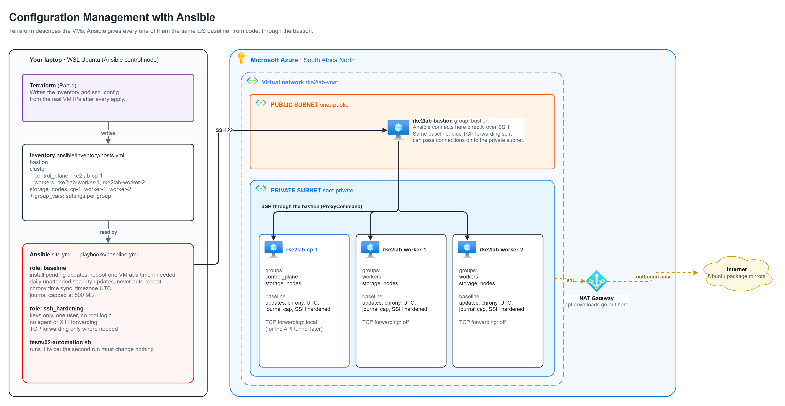

# Part 2: Configuration management with Ansible



## The problem

Part 1 left me with four fresh Ubuntu VMs and nothing on them. Before any
Kubernetes work, every one of them needs the same basics: current security
patches, a correct clock, SSH locked down, logs that can't fill the disk.

I could SSH into each VM and type the commands. That works once. It doesn't
work the second time, when I've forgotten a step, or on the fourth VM, when I
typo a setting, or after a rebuild, when I have to do it all again. Over time
the machines drift apart and nobody knows which one is "right".

So the problem for this part: **describe the OS baseline once, in code, and
apply it to every VM the same way, as often as needed, without breaking
anything that is already correct.**

## What Ansible is and how it works

Terraform built the VMs. Ansible sets up what's inside them. I write down how a
server should look, and Ansible makes every server match it, over SSH.

It has three pieces:

- **An inventory**: the list of machines and the groups they belong to. Here
  Terraform writes it, so it always has the real IPs.
- **Playbooks and roles**: the checklist. A playbook says which roles run on
  which groups; a role is a reusable bundle of tasks.
- **Tasks**: each one describes a state, not a command.

```yaml
- name: Keep chrony running
  ansible.builtin.service:
    name: chrony
    state: started
```

This doesn't mean "start chrony". It means "chrony should be running". Ansible
connects, checks, and only acts if the VM isn't already there. If chrony is
running it reports `ok` and touches nothing; if it's stopped it starts it and
reports `changed`. That is what lets me run the same playbook as often as I
like: the first run does the work, the second run finds nothing to do. The test
for this part checks exactly that.

Nothing gets installed on the VMs for this. Ansible only needs SSH and Python,
and Ubuntu has both. It even reuses the path from Part 1: straight to the
bastion, and through the bastion to the private subnet.

## What gets built

Nothing new in Azure. This part changes what is inside the VMs.

| Piece | What it does |
|---|---|
| Inventory (`ansible/inventory/hosts.yml`) | Written by Terraform. Lists the VMs in groups: `bastion`, `cluster` (with `control_plane` and `workers`) and `storage_nodes`. |
| Group variables (`ansible/inventory/group_vars/`) | Settings per group, for example which hosts may forward SSH connections |
| Role `baseline` | Installs pending updates and reboots one VM at a time if needed, turns on daily security updates without automatic reboots, pins the VM's own name to its private IP, keeps chrony syncing the clock, sets UTC, caps the journal at 500 MB |
| Role `ssh_hardening` | Keys only, one allowed user, no root login, no agent or X11 forwarding, TCP forwarding only on the bastion and control plane |
| `site.yml` | The entry point. Each later part adds its playbook here. |

Ansible runs from WSL on my laptop, because it doesn't run on Windows. In a team
it would run from a CI pipeline instead (Part 8).

## Decisions

### Ansible instead of shell scripts, cloud-init, golden images or Puppet

- **A shell script over SSH** runs top to bottom every time, so running it
  twice can install things twice or append the same line to a file twice.
  Making it safe to re-run means writing the checks yourself for every step.
- **cloud-init** runs once, on first boot. It can't bring an existing VM back
  in line after a change.
- **A golden image built with Packer** bakes the baseline into the VM image.
  Every change means building and rolling out a new image. Good for large
  fleets, too much for four VMs I rebuild often.
- **Puppet, Chef or Salt** keep an agent on every machine and need a server to
  run and secure.
- **Ansible** needs nothing on the VMs except SSH and Python, and only acts
  when a VM isn't already in the state I described.

### Updates: install now, patch daily, never reboot on their own

The first run installs every pending update and reboots any VM that needs it,
one VM at a time. After that, Ubuntu's unattended-upgrades installs security
fixes every day but never reboots by itself.

A Kubernetes control plane rebooting at a random time takes the API down, and
two storage nodes rebooting together could take storage below its safety
margin. Reboots should happen when I decide, one node at a time.

### SSH hardening

| Setting | Why |
|---|---|
| `PermitRootLogin no` | Nobody logs in as root; I use my user and `sudo`, which leaves a trail |
| `AuthenticationMethods publickey` | Keys only, no passwords |
| `AllowUsers azureuser` | Any other account on the VM can't log in over SSH, even with a key |
| `AllowAgentForwarding no` | A compromised VM can't use my SSH agent to hop elsewhere |
| `AllowTcpForwarding` per group | Allowed on the bastion (it forwards my connections) and the control plane (the Kubernetes API tunnel in Part 3), off on the workers |

The role checks the new config with `sshd -t` before reloading SSH, so a typo
fails the run instead of locking me out.

### Each VM's own name in /etc/hosts

The first test run failed on one check: each VM looking up its own name got
back an IPv6 link-local address (`fe80::...`) instead of its private IP. Other
VMs resolved fine through Azure DNS, but a VM never asks DNS about itself.
With no line for its own name in `/etc/hosts`, Ubuntu answers locally and
picks the link-local address.

Kubernetes and etcd use that lookup to decide which address a node advertises,
so this would have shown up in Part 3 as a cluster that half works. The
baseline now writes one line per VM, its own name and private IP, and leaves
everything else to Azure DNS.

### What is not here yet

Kubernetes needs a few more OS changes (kernel modules, network settings, swap
off). Those belong to Part 3, where it's clear why they are needed.

## What the next part needs from this one

Three identical, patched cluster VMs with a correct clock and locked-down SSH,
and a tool that can change all of them at once from code.

Part 3 installs Kubernetes (RKE2) with an Ansible role on top of this baseline,
so the containers have something to run on.

## Code

| File | Contents |
|---|---|
| `ansible/ansible.cfg` | Points Ansible at the inventory and roles |
| `ansible/inventory/group_vars/` | Shared settings and the per-group forwarding rule |
| `ansible/roles/baseline/` | Updates, reboots, unattended upgrades, chrony, timezone, journal limit |
| `ansible/roles/ssh_hardening/` | The sshd settings, checked with `sshd -t` before reload |
| `ansible/playbooks/baseline.yml` | Applies both roles, cluster VMs first and the bastion last |
| `ansible/site.yml` | Runs everything in order |

## Run

From WSL, in the repo folder:

```bash
cd ansible
ansible-playbook site.yml
```

## How I know it works

`tests/02-automation.sh` checks four things. Ansible reaches all four VMs. A
second run of the playbook changes nothing, which proves it's safe to repeat.
Every setting is read back from each VM rather than assumed: chrony in sync,
UTC, security updates without auto-reboot, the journal limit, the SSH settings
as sshd actually applies them, and name lookups. And an SSH login that only
offers a password is refused on every VM.

The first run failed one check, the own-hostname lookup described above, which
is how that problem was found. After the fix, all 8 checks passed.

```bash
bash tests/02-automation.sh
```

<!-- SCREENSHOT
The second run of the playbook, finishing with changed=0 on every VM.
Capture: the terminal after bash tests/02-automation.sh, showing the PLAY RECAP of the second run and the PASS lines.
Blur: bastion public IP.
-->
