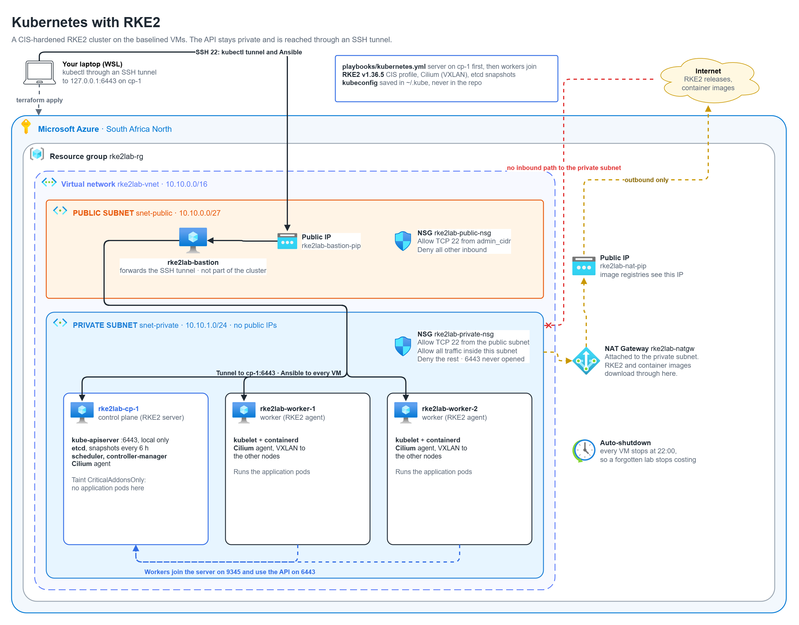

# Part 3: Kubernetes with RKE2



## The problem

After Part 2 I have three identical, patched VMs. Applications still have
nowhere to run. If I start containers on the VMs by hand, nothing restarts them
when they crash, nothing moves them when a VM goes down for patching, and every
change means SSH-ing into a machine.

The problem for this part: **run containers across the three VMs from one API,
so that crashed containers come back, work moves when a node is lost, and the
cluster is locked down from the start rather than hardened later.**

## What Kubernetes and RKE2 do

Kubernetes splits the machines into two roles:

- **The control plane** holds the cluster's state and makes decisions. The
  API server is the single front door for every change, etcd is the database
  that stores the desired and actual state, the scheduler picks a node for each
  new pod, and controllers keep reality matching what was asked for.
- **Workers** run the containers. On each one, the kubelet receives its list
  of pods from the API server and makes containerd run them.

I describe what I want ("two copies of this web server") and Kubernetes keeps
it true: if a pod dies it starts another, if a node disappears it reschedules
the pods elsewhere.

RKE2 is a Kubernetes distribution from SUSE. It packages all of the above, plus
containerd and a network plugin, into one installer with one config file per
node. The control plane runs `rke2-server`; each worker runs `rke2-agent` and
joins the server on port 9345 with a shared token.

## What gets built

| Piece | Where | What it does |
|---|---|---|
| RKE2 server | `rke2lab-cp-1` | API server, etcd, scheduler, controllers. Tainted so application pods never land here. |
| RKE2 agents | `rke2lab-worker-1`, `rke2lab-worker-2` | kubelet and containerd: run the application pods |
| Cilium | every node | Gives every pod an IP and carries traffic between nodes |
| Role `rke2` | `ansible/roles/rke2/` | Installs the server, then joins the agents, waits for all nodes to be Ready, labels the workers and copies the kubeconfig |
| SSH tunnel | laptop to cp-1 | `kubectl` reaches the API on `127.0.0.1:6443` without the port ever being opened |
## Decisions

### RKE2 instead of kubeadm, k3s or AKS

- **AKS** is the managed answer, and Part 1 explains why I'm running my own.
- **kubeadm** is the upstream tool. It builds a bare cluster and leaves the
  container runtime, the network plugin, hardening and upgrades to me.
- **k3s** is light and quick to install, aimed at edge devices. It swaps etcd
  for SQLite by default and isn't built around a security benchmark.
- **RKE2** is built for regulated and air-gapped environments: it ships with
  etcd, containerd and Cilium, and can enforce the CIS Kubernetes Benchmark from
  one setting. It's the closest match to how a bank or a government runs
  Kubernetes on its own hardware, which is what this lab is practising.

### The CIS profile on from day one

`profile: cis` turns on the CIS Kubernetes Benchmark settings: Pod Security
"restricted" for every namespace, API audit logging, and kernel settings that
the kubelet refuses to run without. Under "restricted", a pod can't run as
root, can't gain extra privileges and can't touch the host.

Turning this on later would mean finding every workload that breaks. Turning
it on now means everything I add from here has to be written to run safely,
including the test app in this part. The few platform pieces that genuinely
need host access (storage in Part 5) will get an explicit, documented exception
on their own namespace.
### Application pods stay off the control plane

The control plane carries the taint `CriticalAddonsOnly=true:NoExecute`, so
the scheduler only places cluster add-ons there. etcd stalls when the disk or
CPU is busy, and a stalled etcd freezes the whole cluster, so I keep application
work away from it. This matters even more here, where cp-1 has a single vCPU.

### The API through an SSH tunnel, not a public endpoint

Port 6443 is still not opened anywhere. `kubectl` on my laptop talks to
`127.0.0.1:6443`, and SSH carries that through the bastion to cp-1. Only
someone with my SSH key and my IP can reach the API at all. In a team this
would be a private endpoint behind a VPN.

### Cilium as the network plugin, configured properly in Part 4

Nodes stay `NotReady` until a network plugin is installed, so the cluster can't
be tested without one. RKE2 ships Cilium, so I turn it on here with its default
setup (VXLAN tunnelling between nodes). Part 4 is about the network itself:
network policies, seeing traffic with Hubble, and tuning. Swapping network
plugins on a running cluster later would mean rebuilding it.

### A pinned version and a token outside the repo

RKE2 is pinned to `v1.36.5+rke2r1`, so every rebuild gets the same Kubernetes.
Upgrading becomes a deliberate change to one line.

The join token is generated on first use and stored in `~/.rke2lab/` on the
machine running Ansible. The admin kubeconfig goes to `~/.kube/rke2lab.yaml`.
Neither ever goes into git: anyone holding the kubeconfig has full control of
the cluster.

### etcd snapshots on the node, for now

RKE2 takes an etcd snapshot every 6 hours and keeps the last 10. They sit on
cp-1's own disk, so they don't survive losing the VM. Copying them somewhere
safe is what Part 7 is about.

### One vCPU on the control plane, and what it broke

RKE2 recommends 2 vCPUs for a server node. The Free Trial leaves 1, and the
first install showed what that means.

Every Kubernetes component reserves some CPU, and the scheduler only places a
pod where enough unreserved CPU is left. RKE2's default reservations for the
control plane add up to 1100m, more than the 1000m a single vCPU has. The
control plane started, but when RKE2 tried to run the small job that installs
Cilium, cp-1 refused it: no CPU left to reserve. Without Cilium no node could
become Ready, and the playbook timed out waiting.

The fix was one setting, `control-plane-resource-requests`, bringing the total
down to 500m. These are reservations for scheduling, not limits: each component
can still use the whole vCPU when it's free. After a restart, Cilium installed
and all three nodes were Ready within a minute.

On a real control plane I would keep RKE2's defaults and give it the D2s_v5
from the Terraform defaults, or three of them for a highly available etcd.

### What is not here yet

No ingress controller: nothing is published to the internet yet, so RKE2's
bundled one (Traefik, since v1.36) is turned off. No network policies, storage or monitoring
either. Those are Parts 4 to 6.

## How I know it works

`tests/03-kubernetes.sh` checks:

- **The API stays private.** Even the bastion can't open port 6443 on cp-1
  directly, while `kubectl` through the SSH tunnel reaches the API and reports
  the pinned version.
- **The cluster is healthy.** All 3 nodes are Ready, cp-1 carries its taint,
  the four control plane components are running, every system Deployment and
  DaemonSet has all its replicas ready, and every RKE2 install job finished.
- **Applications run where they should.** A two-replica test app lands on both
  workers and never on cp-1.
- **Pods can reach each other across VMs.** A client pod reaches the app pods
  on both workers by IP, and reaches the service by its cluster DNS name.
- **The hardening is real.** A pod asking for privileged access to the host is
  rejected, and an etcd snapshot can be taken and listed.
- **It's safe to run again.** A second run of the Kubernetes playbook changes
  nothing on any node.

All 16 checks passed. The first version of the health check failed on two
leftover pods from the refused install, even though their jobs had been retried
and completed. Checking raw pod status was the wrong question, so the test now
asks what each component should be doing instead.

```bash
bash tests/03-kubernetes.sh
```
## What the next part needs from this one

A working, hardened cluster where every pod can reach every other pod. That
last part is the problem for Part 4: by default nothing stops one application
from talking to any other. Part 4 adds network policies so pods only reach what
they're meant to, and Hubble to see the traffic.

## Code

| File | Contents |
|---|---|
| `ansible/roles/rke2/tasks/main.yml` | Installs RKE2, applies the CIS kernel settings, writes the config, starts the service |
| `ansible/roles/rke2/templates/` | Server and agent config files |
| `ansible/roles/rke2/tasks/cluster.yml` | Waits for the nodes, labels the workers, copies the kubeconfig |
| `ansible/playbooks/kubernetes.yml` | Server first, then the workers, then the cluster checks |
| `ansible/inventory/group_vars/all.yml` | Pinned version, server IP, token and kubeconfig locations |
| `tests/03-kubernetes.sh`, `tests/03-*.yaml` | The test and the test app |

## Run

From WSL, in the repo folder:

```bash
cd ansible && ansible-playbook playbooks/kubernetes.yml && cd ..
ssh -F ssh_config -N -L 6443:127.0.0.1:6443 rke2lab-cp-1 &
kubectl --kubeconfig ~/.kube/rke2lab.yaml get nodes
```
