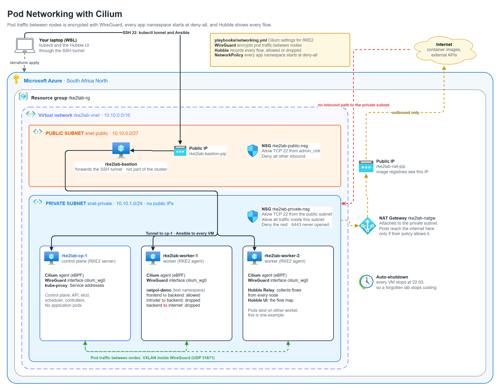
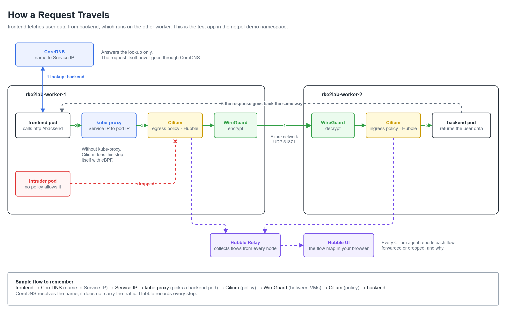

# Part 4: Pod networking with Cilium



## The problem

After Part 3 the cluster network is flat. Any pod can open a connection to any
other pod, in any namespace, on any port. If one application is compromised,
the attacker can reach every other application and database in the cluster
from inside it. That is how a single breach turns into a full one.

Two more gaps: traffic between pods on different VMs crosses the Azure network
unencrypted, and nothing records which pods talk to which, so a blocked or
unexpected connection is invisible.

The problem for this part: **pods only reach what they're meant to, traffic
between nodes is encrypted, and every connection, allowed or blocked, can be
seen.**

## Remember these components

| Component | What it does | What I use for it here |
|---|---|---|
| Pod | Runs the app. Gets its own IP, which changes when the pod is recreated | `frontend`, `backend` and `intruder` in the test app |
| Service | One stable name and IP (the ClusterIP) in front of a group of pods | `backend`, in front of the backend pods |
| CoreDNS | Turns a Service name into its Service IP (service discovery) | Comes with RKE2 |
| kube-proxy | Rules on every node that send traffic for a Service IP to one of its pods | Comes with RKE2, kept for now |
| CNI plugin | Gives pods their IPs and carries packets between them, on the same node or across nodes | Cilium, with eBPF programs in the Linux kernel |
| NetworkPolicy | The rules for which pods may talk to which | Deny by default, then one rule per allowed connection. Cilium enforces them |
| WireGuard | Encrypts traffic between two machines | Cilium's encryption between nodes (`cilium_wg0`, UDP 51871) |
| Hubble | Records every connection, forwarded or dropped, and why | Built into the Cilium agent on every node |
| Hubble Relay | Collects the flows from every node into one place | Runs on a worker |
| Hubble UI | Shows the flows as a map in the browser | Opened with `kubectl port-forward` through the SSH tunnel |



### How the communication works

A simple example from the test app: `frontend` needs to fetch user data from
`backend`, and the two pods sit on different workers.

1. **frontend pod:** calls `http://backend` instead of a hardcoded IP, because
   pod IPs change whenever pods are recreated.
2. **CoreDNS:** resolves `backend` to the Service's stable IP (the ClusterIP).
   This is service discovery.
3. **kube-proxy:** its rules on worker-1 send traffic for the Service IP to one
   of the backend pod IPs.
4. **Cilium on worker-1 (CNI Plugin):** Enforces network policies and provides the network connectivity needed for packets to reach the selected backend pod, whether it's on the same node or a different node.
5. **WireGuard:** the packet is leaving the VM, so it's encrypted on worker-1,
   crosses the Azure network, and is decrypted on worker-2.
6. **Cilium on worker-2:** checks the ingress policy. backend only accepts
   traffic from frontend, so the packet is delivered.
7. **backend pod:** receives the request, processes it and sends the response
   back to frontend the same way.

At every step, the Cilium agent on that node hands the flow to **Hubble**.
**Hubble Relay** collects the flows from all nodes and the **Hubble UI** shows
them, so the intruder's drop shows up with the policy that caused it.

### What if kube-proxy is not used?

- kube-proxy is what normally turns a Service IP into a pod IP, using rules on
  each node.
- If kube-proxy isn't there, something else has to do that job.
- Cilium can replace it with eBPF and do the Service load balancing itself.
  Step 3 then happens inside Cilium, and the rest of the flow stays the same.
  I leave that for later (see the decisions below).

One important detail: CoreDNS only resolves the name. It doesn't forward the
application traffic. The request itself goes from the frontend pod through the
node's networking to the backend pod.

## What gets built

| Piece | Where | What it does |
|---|---|---|
| Role `cilium` | `ansible/roles/cilium/` | Writes Cilium's settings to the folder RKE2 watches on cp-1, then waits until Hubble is running and WireGuard is active on every node |
| WireGuard | every node | Encrypts pod traffic between nodes (`cilium_wg0`, UDP 51871) |
| Hubble Relay and UI | a worker | Collect and show the flows from every node |
| Default-deny policies | `kubernetes/network-policies/default-deny.yaml` | The starting point for every application namespace: nothing in, nothing out, except DNS |

## Decisions

### Cilium's settings through RKE2, not a separate install

RKE2 installs Cilium from its own Helm chart. Instead of installing Cilium a
second way, I give RKE2 my settings in a `HelmChartConfig` file in
`/var/lib/rancher/rke2/server/manifests/`. RKE2 notices the file and re-applies
the chart with my values on top. The settings live in the repo, and an RKE2
upgrade still upgrades Cilium with it.

### Deny by default, allow explicitly

Each application namespace starts with two policies: deny everything in and
out, and allow DNS lookups to CoreDNS. Every connection the app needs is then
its own small policy. A new app is isolated until someone decides what it may
talk to, which is the opposite of today's "everything is open until someone
closes it".

I apply this per application namespace, not cluster-wide. A blanket deny across
`kube-system` would cut off the components the cluster itself depends on.

### Standard NetworkPolicy, not Cilium's own policy types

Kubernetes NetworkPolicy works on any cluster with any network plugin, so the
policies stay portable. Cilium's own `CiliumNetworkPolicy` can go further:
allowing egress only to named domains (for example `api.github.com`), or only
to certain HTTP paths. That's the natural next step once there are real
applications with real outside dependencies.

### WireGuard encryption between nodes

Azure doesn't encrypt traffic inside a VNet by default, and inside the VXLAN
tunnel pod traffic is readable to anything on the path. WireGuard fixes that
with one setting. I chose it over IPsec, Cilium's other option, because
WireGuard is built into the kernel, has no keys for me to manage, and is
simpler and faster.

It costs some CPU on every packet between nodes, which matters on 1 vCPU VMs.
The tests run with it on. Traffic between two pods on the same node never leaves
the machine and isn't encrypted.

### Hubble on, reached through the tunnel

Without Hubble, a policy that blocks the wrong thing looks exactly like an app
that's broken. With it, the drop shows up with the policy that caused it. The
Hubble UI isn't exposed to the internet; like the API, it's reached with
`kubectl port-forward` over the SSH tunnel.

### kube-proxy stays, for now

Cilium can replace kube-proxy and handle Services with eBPF too, which is faster
with many Services and frees kube-proxy's CPU. Doing it means changing RKE2's
config on every node and restarting them all, on a cluster that's already short
of CPU, in the same part as the policy changes. If something broke I couldn't
tell which change caused it. It's a good follow-up on its own.

### What is not here yet

Policies by domain name or HTTP path, and kube-proxy replacement, as above.
Policies for real applications come with the applications themselves in Part 8.

## How I know it works

`tests/04-networking.sh` checks:

- **Cilium is healthy and Hubble is running.** The Cilium agent reports OK on
  all three nodes, and Hubble Relay is up.
- **Traffic between nodes is encrypted.** Every node reports WireGuard active,
  with the other two nodes as peers.
- **The one allowed connection works.** In a test namespace with default deny,
  `frontend` reaches `backend`, and DNS lookups still work.
- **Everything else is blocked.** An `intruder` pod in the same namespace can't
  reach `backend`, a pod in another namespace can't reach it either, and
  `backend` can't reach the internet, while a pod without policies can (so the
  block is the policy, not the network).
- **The block is visible.** Hubble shows the intruder's attempt as `DROPPED` by
  policy.
- **It's safe to run again.** A second run of the networking playbook changes
  nothing.

```bash
bash tests/04-networking.sh
```

## What the next part needs from this one

A cluster where pods are isolated by default and traffic between nodes is
encrypted. What the pods still can't do is keep data: if a pod restarts or moves
to the other worker, anything it wrote is gone. Part 5 adds storage with
Rook-Ceph, using the empty data disks from Part 1.

## Code

| File | Contents |
|---|---|
| `ansible/roles/cilium/templates/rke2-cilium-config.yaml.j2` | Cilium settings: WireGuard, Hubble, Relay and UI |
| `ansible/roles/cilium/tasks/main.yml` | Writes the settings, waits for Hubble and WireGuard |
| `ansible/playbooks/networking.yml` | Runs the role on the control plane |
| `kubernetes/network-policies/default-deny.yaml` | The default-deny and allow-DNS policies for app namespaces |
| `tests/04-networking.sh`, `tests/04-demo.yaml` | The test and its demo app |

## Run

From WSL, in the repo folder:

```bash
cd ansible && ansible-playbook playbooks/networking.yml && cd ..
```

To open the Hubble UI, with the tunnel from Part 3 running:

```bash
kubectl -n kube-system port-forward svc/hubble-ui 12000:80
```

Then browse to http://localhost:12000.
