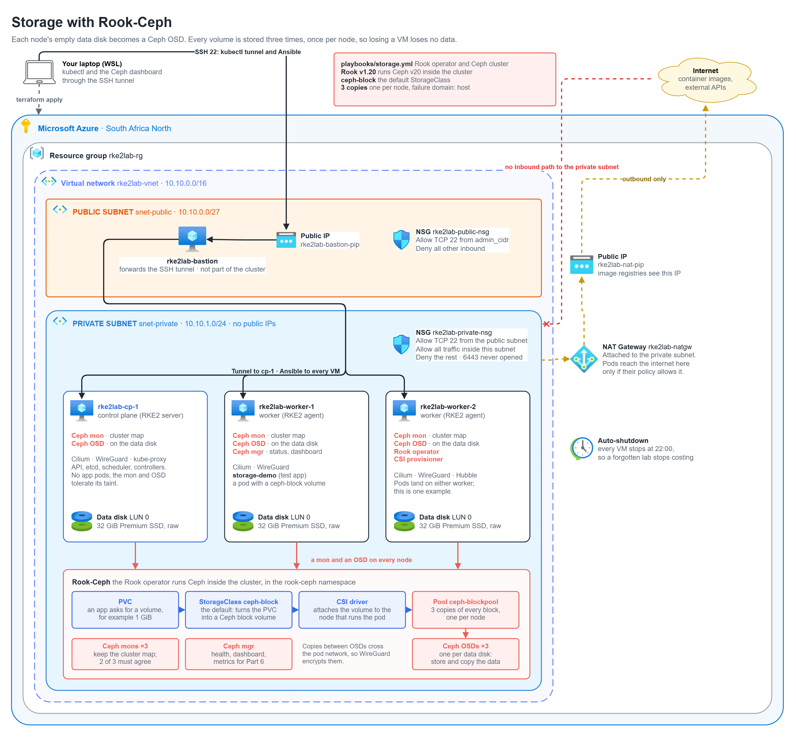
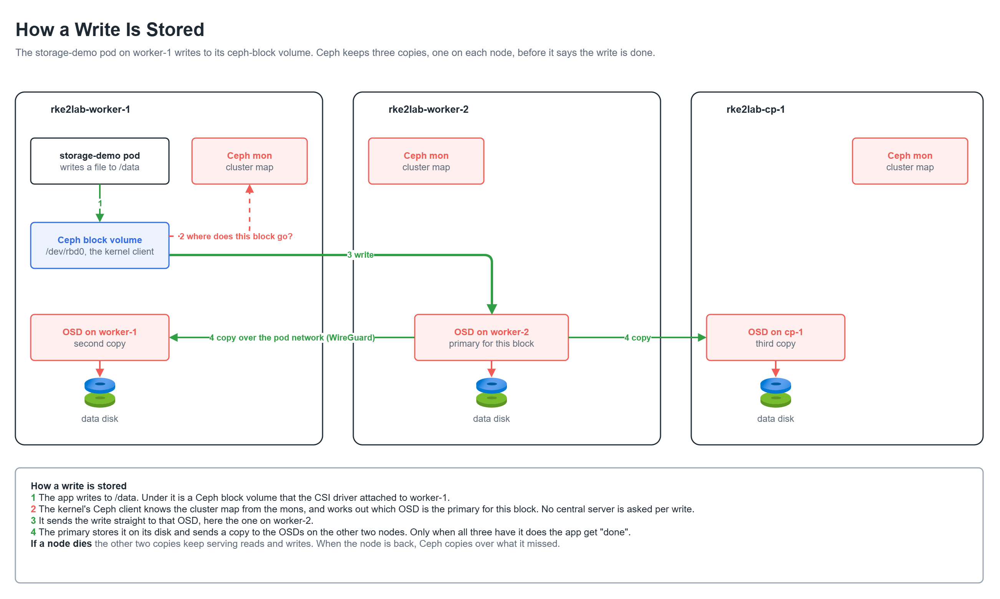
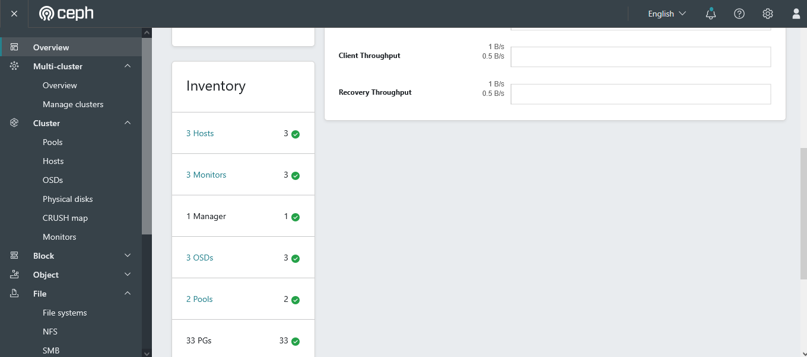
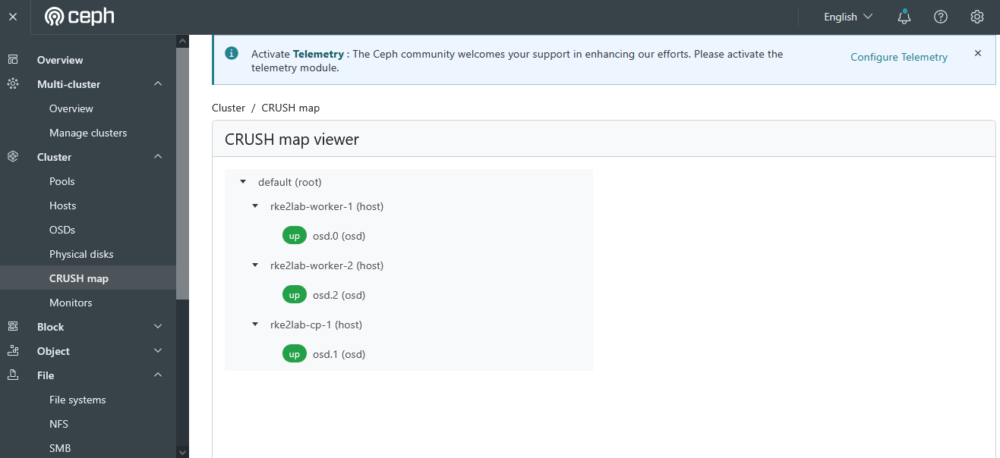
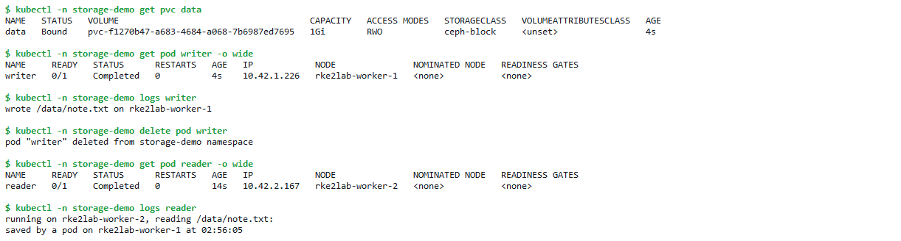
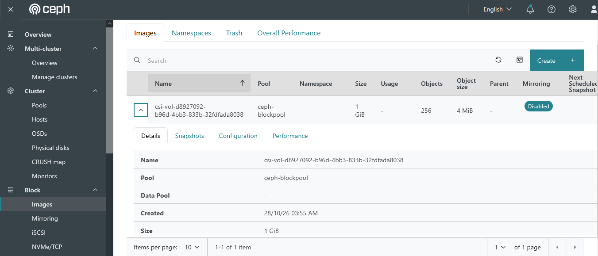
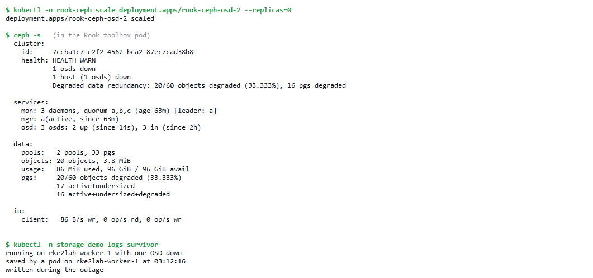
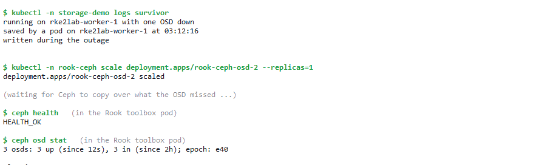

# Part 5: Storage with Rook-Ceph



## The problem

After Part 4 the cluster runs pods safely, but none of them can keep data. A
pod writes to its own container filesystem, and when the pod restarts or moves
to the other worker, everything it wrote is gone. That rules out databases,
uploaded files, and the metrics and logs Part 6 needs to keep.

Part 1 gave every node an empty 32 GiB disk for this. Nothing uses them yet.

The problem for this part: **an app asks for storage and gets a volume that
follows it to any node and survives losing a VM.**

## Remember these components

| Component | What it does | What I use for it here |
|---|---|---|
| PVC (PersistentVolumeClaim) | An app's request for storage: "I need 1 GiB" | The `storage-demo` test app asks for one |
| StorageClass | Says how a PVC becomes a real volume | `ceph-block`, the cluster default |
| PV (PersistentVolume) | The volume itself, created to match the PVC | A Ceph block volume (RBD image) |
| CSI driver | Creates volumes, and attaches them to the node that runs the pod | Ceph CSI, installed by Rook |
| Rook | An operator: turns a few YAML objects into a running Ceph cluster, and keeps it running | Rook v1.20, in the `rook-ceph` namespace |
| Ceph | Storage system that spreads data over many disks and keeps several copies | Ceph v20, run by Rook |
| OSD | The Ceph daemon that owns one disk and stores data on it | One per data disk, so 3 |
| Mon | Keeps the cluster map: which OSDs exist and where each piece of data goes. 2 of 3 must agree | 3, one per node |
| Mgr | Health, the dashboard and metrics | 1, the dashboard reached through the SSH tunnel |
| Pool | A group of data with its own rules | `ceph-blockpool`: 3 copies, never two on the same node |



### How a write is stored

A simple example: the `storage-demo` pod on worker-1 saves a file to `/data`.

1. **storage-demo pod:** writes the file to `/data`. It doesn't know Ceph
   exists; `/data` is just a disk to it.
2. **Ceph block volume:** under `/data` is a Ceph block volume that the CSI
   driver attached to worker-1 (`/dev/rbd0`). The kernel's Ceph client turns
   the write into blocks.
3. **Mons:** the client already has the cluster map from the mons, and works out
   which OSD is the primary for each block. Nobody is asked per write, so there
   is no central server to slow things down or fail.
4. **Primary OSD:** the client sends the block straight to that OSD, here the
   one on worker-2.
5. **The copies:** the primary writes the block to its disk and sends a copy to
   the OSDs on the other two nodes. These copies cross the pod network, so
   WireGuard from Part 4 encrypts them.
6. **Done:** only when all three copies are on disk does the app get "done".

If a node dies, the other two copies keep serving reads and writes. When the
node comes back, Ceph copies over what it missed.

### Simple flow to remember

PVC → StorageClass `ceph-block` → CSI driver (creates and attaches the volume)
→ pod writes → primary OSD → copies to the other two OSDs → done.

One important detail: the mons only hand out the map. The data itself goes
straight from the node running the pod to the OSDs.

## What gets built

| Piece | Where | What it does |
|---|---|---|
| Role `rook_ceph` | `ansible/roles/rook_ceph/` | Writes the Rook and Ceph Helm settings to the folder RKE2 watches on cp-1, then waits until Ceph is healthy |
| Rook operator | a worker | Creates and looks after the Ceph daemons |
| Ceph mons and OSDs | every node | Keep the map, and store the data on the data disks |
| Ceph mgr | a worker | Health, dashboard and metrics |
| Ceph CSI driver | a controller on a worker, a node plugin on each worker | Creates volumes for PVCs and attaches them to the node running the pod |
| StorageClass `ceph-block` | cluster-wide | The default way apps get a volume |

## Decisions

### Rook-Ceph, not Azure Disks, local disks or Longhorn

- **Azure Disk CSI** creates one Azure disk per volume. Only one VM can use a
  disk at a time, and when a node dies, moving its disks to another VM takes
  minutes. It also needs Azure credentials inside the cluster and ties the
  platform to Azure.
- **local-path** keeps the data on the node that runs the pod, with no copies.
  Lose the node, lose the data.
- **Longhorn** is the fair rival: simpler, from Rancher like RKE2, and lighter.
  But it only does block storage. Ceph is what large self-managed platforms run,
  and it also does shared filesystems and S3-style object storage later without
  adding another system. The price is that Ceph is heavier, which matters on
  1 vCPU VMs.

### Settings through RKE2, like Cilium

Rook v1.20 comes as three Helm charts: the operator, the CSI drivers, and the
Ceph cluster. As in Part 4, Ansible writes them as `HelmChart` files to
`/var/lib/rancher/rke2/server/manifests/` and RKE2 installs them. Versions are
pinned: Rook v1.20.9, Ceph v20.2.4, CSI drivers 1.0.4 (the same version as the
CSI operator Rook installs). I chose v1.20 over the newer v1.21 because it has
had nine patch releases, and it supports Kubernetes 1.31 to 1.37.

My first version only had the operator and the cluster, because that's how Rook
used to install. Ceph came up healthy, but no CSI driver ran, so a PVC could
never get a volume. Since v1.20 the drivers are their own chart, and it has to
use Rook's values.

### Sized for 1 vCPU VMs

Rook's defaults ask for a full CPU for every mon and every OSD, and 4 GiB of
memory per OSD. Each VM here has 1 CPU, and the control plane already uses most
of it. I set small requests (about 50m CPU per mon, 100m per OSD, 1.5 GiB memory
per OSD). At idle Ceph uses very little, so this is fine for a lab. In
production Ceph gets its own nodes with at least 4 CPUs.

### 3 copies, one per node

The pool keeps 3 copies of every block, and the failure domain is the host, so
no two copies land on the same VM. That turns 96 GiB of disk into about 30 GiB
of usable space, and any one node can be lost. Writes still work with 2 of the
3 copies, then Ceph catches up.

### Ceph on the control plane too

Ceph needs 3 machines and the Free Trial only has 2 workers, so cp-1 is the
third storage node. Only the Ceph mon and OSD tolerate its taint; apps still
never run there. With 3 workers this goes away.

### Block storage only, for now

Shared filesystems (CephFS) and object storage both need extra daemons this
cluster can't afford, and nothing uses them yet. They're one setting each when
an app needs them.

### One privileged namespace

OSDs need direct access to the raw disk, which the CIS "restricted" Pod
Security level doesn't allow. Only the `rook-ceph` namespace is labelled
`privileged`. Every other namespace stays restricted, and the Part 3 test that
rejects a privileged pod still has to pass.

### Only strong keys

Every Ceph daemon and client logs in with a key. The cluster chart gives the
CSI driver's keys the older `aes` type, for nodes on Linux kernels before 7.0,
and Ceph reports those as insecure (`HEALTH_WARN`). These nodes run kernel 7.0,
so:

- the CSI keys use `aes256k` like the rest, and are rotated to generation 2 to
  replace the ones the cluster was first created with. No old keys are kept.
  Raising the generation later rotates them again.
- `aes` is refused outright (`allowedCiphers: [aes256k]`): no new weak keys can
  be made and none can log in.

Refusing a cipher locks out any daemon whose key still uses it, so before
setting it I checked the type of every key in the cluster. All were `aes256k`.

### Encrypted in transit and at rest, without Ceph's own encryption

Ceph copies blocks between nodes over the pod network, so WireGuard already
encrypts them. Azure encrypts managed disks at rest. Ceph can encrypt its disks
too, but it costs CPU I don't have, for no extra protection here.

### What is not here yet

Backups of the volumes (Part 7), and Ceph metrics in a dashboard (Part 6, from
the mgr).

## How I know it works

`tests/05-storage.sh` checks:

- **Ceph is healthy.** `HEALTH_OK`, 3 mons in quorum, 3 OSDs up, one on each
  node.

  

- **The copies are spread.** The pool keeps 3 copies, one per host, and
  `ceph-block` is the default StorageClass. The CRUSH map is what Ceph uses to
  place the copies: each host holds one OSD, and the pool's rule puts each copy
  on a different host.

  

- **Data follows the pod.** A pod writes a file to a PVC on one worker, gets
  deleted, and a new pod on the other worker reads the same file.

  

  Behind the PVC is a 1 GiB Ceph block image in `ceph-blockpool`, created by
  the CSI driver.

  

- **Losing a node loses nothing.** With one OSD stopped, the volume can still be
  read and written, and Ceph reports the missing copy. When the OSD is back,
  Ceph returns to `HEALTH_OK`.

  

  With the OSD started again, Ceph copies over what it missed and is back to
  `HEALTH_OK` within seconds.

  

- **Only Ceph is privileged.** The `rook-ceph` namespace is privileged, and a
  privileged pod is still rejected everywhere else.
- **It's safe to run again.** A second run of the storage playbook changes
  nothing.

The first runs of the playbook never reached `HEALTH_OK`, for the two reasons
above: the missing CSI drivers chart, and the `aes` keys. After both fixes, all
14 checks passed, and the Part 3 and Part 4 tests still pass.

```bash
bash tests/05-storage.sh
```

## What the next part needs from this one

Volumes that survive restarts and node loss. With storage in place, Part 6 adds
monitoring: Prometheus needs somewhere to keep its data, and Ceph's mgr has
metrics ready for it.

## Code

| File | Contents |
|---|---|
| `ansible/roles/rook_ceph/templates/rook-ceph.yaml.j2` | The Rook operator chart and its settings |
| `ansible/roles/rook_ceph/templates/ceph-csi-drivers.yaml.j2` | The CSI drivers chart, with only the block storage driver on |
| `ansible/roles/rook_ceph/templates/rook-ceph-cluster.yaml.j2` | The Ceph cluster: mons, OSDs on the data disks, key settings, the pool and `ceph-block` |
| `ansible/roles/rook_ceph/tasks/main.yml` | Writes the settings, waits for Ceph, the CSI driver and `ceph-block` |
| `ansible/playbooks/storage.yml` | Runs the role on the control plane |
| `tests/05-storage.sh`, `tests/05-demo.yaml` | The test and its demo app |

## Run

From WSL, in the repo folder:

```bash
cd ansible && ansible-playbook playbooks/storage.yml && cd ..
```

To open the Ceph dashboard, with the tunnel from Part 3 running:

```bash
kubectl -n rook-ceph get secret rook-ceph-dashboard-password -o jsonpath='{.data.password}' | base64 -d; echo
kubectl -n rook-ceph port-forward svc/rook-ceph-mgr-dashboard 8443:8443
```

Then browse to https://localhost:8443 and log in as `admin` with that password.
The certificate is self-signed, so the browser warns once.
