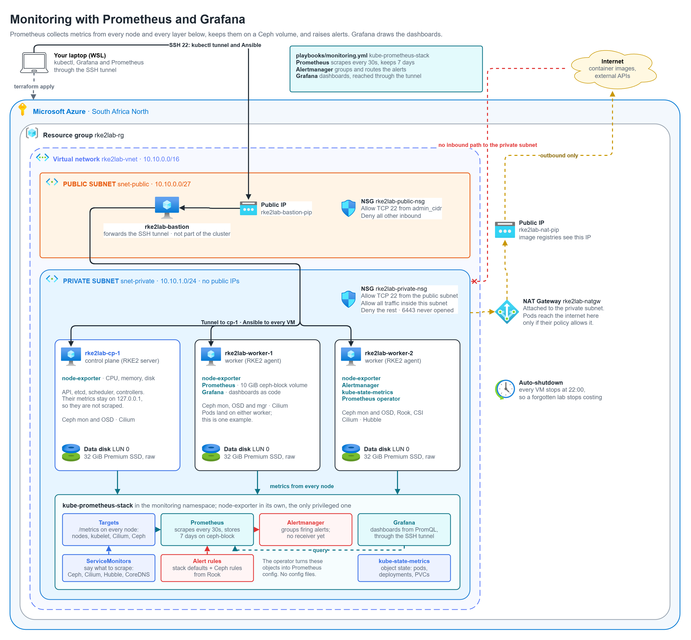
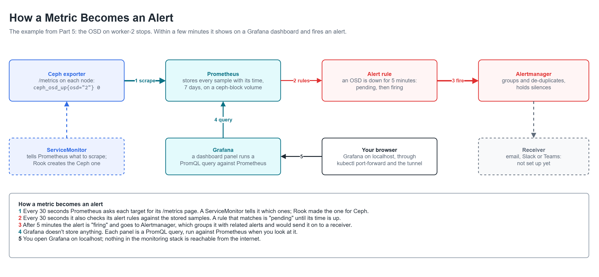

# Part 6: Monitoring with Prometheus and Grafana



## The problem

After Part 5 the platform has a cluster, a network and storage, but the only way
to know how any of it is doing is to log in and run commands. Nothing watches
it. A full disk, a node running out of memory, an OSD that stopped, or etcd
getting slow would go unnoticed until something broke, and then there would be
no history to show when it started.

The problem for this part: **every layer reports its numbers to one place, the
numbers are kept long enough to look back, problems raise an alert on their
own, and all of it can be seen on dashboards.**

## Remember these components

| Component | What it does | What I use for it here |
|---|---|---|
| Metric | A named number with labels, for example `node_memory_MemAvailable_bytes{instance="worker-1"}` | Thousands of them, from every layer |
| /metrics | A plain-text page a program serves with its current metrics | node-exporter, the kubelets, the API server, Cilium, Ceph and more |
| Exporter | A small program that reads something and serves it as /metrics | node-exporter (the VM), kube-state-metrics (Kubernetes objects), Ceph exporter |
| Prometheus | Asks every target for its /metrics on a schedule (scraping) and stores every sample with its time | Every 30 seconds, 7 days kept, on a ceph-block volume |
| ServiceMonitor | A Kubernetes object that tells Prometheus what to scrape | One per target; Rook and Cilium create their own |
| Prometheus operator | Turns ServiceMonitors and alert rules into Prometheus config | Part of kube-prometheus-stack |
| PromQL | Prometheus's query language | Used by the dashboards and the alert rules |
| Alert rule | A PromQL condition and how long it must hold, for example "an OSD is down for 5 minutes" | The stack's default rules, plus Ceph's from Rook |
| Alertmanager | Receives firing alerts, groups and de-duplicates them, holds silences, sends them on | Running, with no receiver yet |
| Grafana | Draws dashboards; each panel is a PromQL query | Dashboards for nodes, Kubernetes, Cilium and Ceph, as code |



### How a metric becomes an alert

A simple example, the one from Part 5: the OSD on worker-2 stops.

1. **Ceph exporter:** its /metrics page now says the OSD is down
   (`ceph_osd_up{osd="2"} 0`).
2. **Prometheus:** scrapes that page within 30 seconds and stores the sample.
   The ServiceMonitor Rook created is what told it to scrape there.
3. **Alert rule:** Prometheus checks its rules every 30 seconds. The OSD rule
   matches, so the alert is "pending". If the OSD is still down after 5 minutes,
   it's "firing".
4. **Alertmanager:** receives the firing alert, groups it with related ones
   (Ceph also reports degraded data), and would send it to a receiver.
5. **Grafana:** a Ceph dashboard shows the OSD count drop and the degraded data.
   Grafana stores nothing itself; it asks Prometheus when you open the page.

### Simple flow to remember

/metrics → Prometheus (scrape, store) → alert rule (pending, firing) →
Alertmanager → receiver. Grafana → PromQL → Prometheus → dashboard.

One important detail: Prometheus pulls. Targets don't send anything; if a
target stops answering, that itself is a metric (`up == 0`) and an alert.

## What gets built

| Piece | Where | What it does |
|---|---|---|
| Role `monitoring` | `ansible/roles/monitoring/` | Installs kube-prometheus-stack through RKE2 and waits until every target is up |
| Prometheus | a worker | Scrapes and stores the metrics on a 10 GiB ceph-block volume |
| Alertmanager | a worker | Receives the alerts |
| Grafana | a worker | Dashboards, reached through the SSH tunnel |
| node-exporter | every node | The VM's own numbers: CPU, memory, disk, network |
| kube-state-metrics | a worker | The state of Kubernetes objects: pods, deployments, PVCs |
| Metrics settings | roles `cilium` and `rook_ceph` | Turn on Cilium, Hubble and Ceph metrics, alert rules and dashboards once the Prometheus operator is installed |

## Decisions

### kube-prometheus-stack, not a hosted service or a lighter stack

- **Azure Monitor managed Prometheus** would store the metrics in Azure, but it
  needs the cluster connected through Azure Arc, sends the data out of the
  private network, and costs per sample. The rest of this platform runs inside
  it, so the monitoring does too.
- **Datadog, Grafana Cloud** and similar services: the same, plus an agent with
  an API key in the cluster.
- **VictoriaMetrics** is lighter and speaks PromQL, but the ServiceMonitors and
  alert rules that Rook and Cilium ship are written for the Prometheus operator.
- **kube-prometheus-stack** is the standard: Prometheus, Alertmanager, Grafana,
  node-exporter and kube-state-metrics with the operator, plus a tested set of
  dashboards and alert rules for Kubernetes. Pinned at chart 92.10.1.

### Installed through RKE2, like Cilium and Rook

The chart goes in as a `HelmChart` file on cp-1, the same way as Parts 4 and 5.

### Metrics from every layer below

Out of the box Prometheus would only see the nodes and Kubernetes objects. The
layers below get their metrics turned on:

- **Ceph:** Rook's `monitoring` setting creates the ServiceMonitors and Ceph's
  alert rules.
- **Cilium and Hubble:** the Part 4 settings gain metrics and ServiceMonitors,
  so dropped packets and DNS errors show up too.

Both need the Prometheus operator's object types (ServiceMonitor,
PrometheusRule) to exist, and on a fresh build they don't yet when Parts 4 and
5 run. So the `cilium` and `rook_ceph` roles check for them and only turn their
metrics on when they're there. The monitoring playbook installs the stack, then
runs both roles again. Running either part on its own later keeps the metrics
on, because the types are still there.

### The control plane stays unscraped

RKE2 binds the metrics of etcd, the scheduler, the controller manager and
kube-proxy to `127.0.0.1`, out of Prometheus's reach. Moving them to the node's
IP means changing RKE2's config and restarting it on every node, including about
a minute without the API on cp-1. I left them where they are, and switched off
the stack's scraping, dashboards and alert rules for those four, so nothing
shows a false "target down". The API server, the kubelets and CoreDNS are still
scraped. Watching etcd is the first thing I'd add on a bigger cluster.

### 7 days of history on a Ceph volume

Prometheus keeps its data on a 10 GiB ceph-block volume, so a restart or a move
to the other worker loses no history. It keeps 7 days or 8 GiB, whichever comes
first. Long-term storage (Thanos or Mimir, in object storage) is for when
someone needs months.

### Sized for 1 vCPU VMs

The chart sets no requests, so I set small ones: about 100m CPU and 1 GiB for
Prometheus, 50m for Grafana, 10m for each exporter and Alertmanager. Together
that's under 300m on the workers, which have about 600m left. cp-1 only runs
node-exporter.

### Dashboards as code, no Grafana volume

Grafana's dashboards come from ConfigMaps in the repo (the stack's own, plus
Ceph's and Cilium's), and its data source points at Prometheus. Nothing is
clicked together and saved inside Grafana, so it needs no volume and a rebuild
gets the same dashboards.

### Alerts with nowhere to go, for now

Alertmanager runs with the stack's default and Ceph's alert rules, but no
receiver. Sending alerts to email, Slack or Teams needs a credential in the
cluster, and secrets come with GitOps in Part 8. Until then the alerts are
visible in Alertmanager and Grafana.

### One privileged namespace for node-exporter

node-exporter reads the host's own files and network, which the CIS
"restricted" level forbids. It runs in its own namespace, `monitoring-node`,
labelled privileged. Prometheus, Grafana and Alertmanager stay in `monitoring`,
which stays restricted.

### Reached through the tunnel only

Grafana, Prometheus and Alertmanager have no ingress and no public address.
They're opened with `kubectl port-forward` over the SSH tunnel. Grafana's admin
password is generated at install and kept in a Kubernetes secret.

### What is not here yet

Logs (Loki), alert receivers (Part 8), long-term storage, and the control
plane's own metrics (etcd, scheduler, controller manager, kube-proxy).

## How I know it works

`tests/06-monitoring.sh` checks:

- **Everything is scraped.** Every target Prometheus knows is up, including
  the API server, the kubelets, CoreDNS, Cilium, Hubble and Ceph.
- **Every node reports.** node-exporter answers on all 3 nodes.
- **The alert path works.** The always-firing `Watchdog` alert reaches
  Alertmanager, which proves rules are evaluated and alerts delivered.
- **Ceph is visible.** Prometheus has Ceph's health and OSD metrics, and they
  match what `ceph -s` says.
- **A problem shows up.** With one OSD stopped, Prometheus sees it down, and
  when it's back, up again.
- **History survives a restart.** Prometheus is deleted and comes back with its
  old samples, because they're on the Ceph volume.
- **Grafana works.** It answers, has its Prometheus data source, and has the
  Kubernetes, node and Ceph dashboards.
- **It's safe to run again.** A second run of the monitoring playbook changes
  nothing.

```bash
bash tests/06-monitoring.sh
```

## What the next part needs from this one

A way to see that the platform is healthy, and to notice when it isn't. Part 7
adds backups and recovery, and the restore tests can use these dashboards to
show the cluster coming back.

## Code

| File | Contents |
|---|---|
| `ansible/roles/monitoring/templates/kube-prometheus-stack.yaml.j2` | The chart and its settings |
| `ansible/roles/monitoring/tasks/main.yml` | Writes the settings, waits until every target is up |
| `ansible/playbooks/monitoring.yml` | Runs the role |
| `tests/06-monitoring.sh` | The test |

## Run

From WSL, in the repo folder:

```bash
cd ansible && ansible-playbook playbooks/monitoring.yml && cd ..
```
